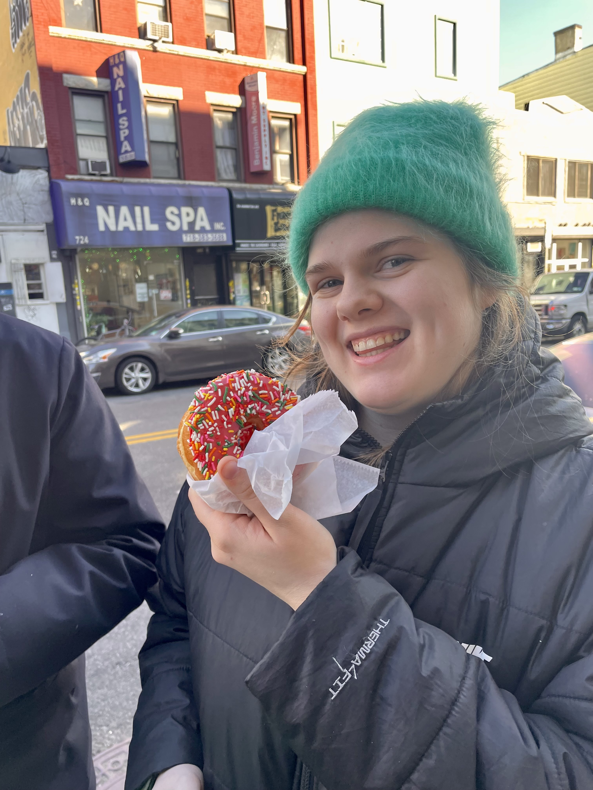

{width=200}

## Professional
I am a junior psychology Macalester College in St Paul, Minnesota. I have experience working in grant writing, fundraising, and finance for non-profit organizations. I also have experience working as an educator with middle and high school students.

## Personal 

Growing up in New York inspired a interest for internationalism and a love for travel. I am always love to be exploring, whether its meeting new friends abroad or exploring a new neighborhood in my city. Moving to the Twin Cities has introduced many new neighborhoods to explore.

## Education

**Macalester College**

- BA Expected May 2028
- Course work is Psychology, Education, Statistics, and Research Methods

**Red Cross CPR and First Aid Certified**

## Contact

Feel free to reach out!

Either via email (avoorham@macalester.edu)
or via [LinkedIn](https://www.linkedin.com/in/anna-lies-voorham-417598240/).

